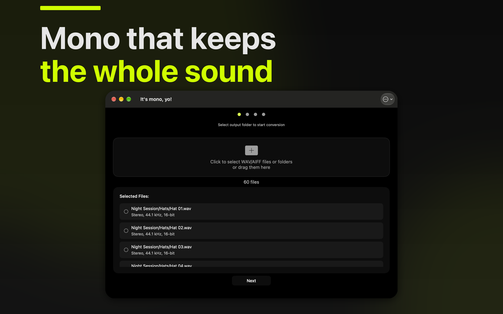

# It's mono, yo!

Convert stereo to mono. Easy.

<!-- IAMJARL README store block for It's mono, yo! (en). Generated from apps.json, v1.34.0. Do not edit. -->
<p>
  <a href="https://apps.apple.com/app/id6758866918?pt=128512007&amp;ct=github&amp;mt=12"><picture>
    <source media="(prefers-color-scheme: dark)" srcset="https://raw.githubusercontent.com/JarlLyng/iamjarl-design/v1.34.0/badges/mac-app-store-white-en-us.svg">
    
  </picture></a>
  <br>
  $0.99 once · macOS 12 or later · <a href="https://itsmonoyo.iamjarl.com">itsmonoyo.iamjarl.com</a>
</p>

<p>
  
</p>

It's mono, yo! batch converts stereo WAV and AIFF files to mono, for anyone loading samples onto a hardware sampler like the Erica Synths Sample Drum, an Elektron Digitakt or a Roland SP-404. It adds left and right at half level each, so a sound panned to one side isn't lost. Drop in a whole sample pack and the output keeps its folders, as WAV or AIFF, in 16-bit, 24-bit or 32-bit float, at the original sample rate or at 44.1, 48 or 96 kHz. The app has no network access: your audio is converted on your Mac, your originals are never changed, and nothing is collected.

## For developers

<p>
  <a href="https://madebyhuman.iamjarl.com"><picture>
    <source media="(prefers-color-scheme: dark)" srcset="https://madebyhuman.iamjarl.com/badges/co-created-white.svg">
    </picture></a>
  <a href="LICENSE"></a>
</p>

The developer half: what the app does in detail, how to build and run it, how it is put together, how to contribute, and the license.

### Features

- **Batch conversion:** drag in as many WAV and AIFF files as you like. There's no file count or size limit.
- **Folder import:** drop a whole folder, and every WAV and AIFF inside it converts, subfolders included, into the same folder structure in the output.
- **Bit depth:** 16-bit (default), 24-bit or 32-bit float.
- **Output format:** WAV or AIFF.
- **Sample rate:** keep the original, or convert to 44.1, 48 or 96 kHz.
- **Stereo downmix:** left and right are summed at half level each, not just the left channel kept.
- **Multichannel files:** surround layouts like 5.1 are folded down with the ITU-R BS.775 weights.
- **Overwrite protection:** if a name is taken, the new file gets a number. Nothing is replaced.
- **Drag and drop**, or **⌘O** to open files.
- **Accessibility:** VoiceOver, Reduce Motion and system dark mode.
- **Native macOS:** SwiftUI, small, with no internet connection needed.

### Build and run

1. Clone the repository:
   ```bash
   git clone https://github.com/JarlLyng/It-s-mono-yo-.git
   ```
2. Open `It's mono, yo!.xcodeproj` in Xcode 16 or later.
3. Pick your development team in the signing settings.
4. Build and run with the **SampleDrumConverter** scheme (⌘R). The project was renamed, the scheme wasn't.
5. Run the tests with **Product → Test** (⌘U).

It needs macOS 12.0 or later. Releases build in Xcode Cloud; see [XCODE_CLOUD.md](XCODE_CLOUD.md).

### Usage

1. Launch the app.
2. Add audio files: click the drop area (⌘O), or drag files or folders onto it.
3. Choose an output folder, then the format, bit depth and sample rate.
4. Press Start.
5. Open the converted files with "Show in Finder".

### Architecture

- **Audio engine:** AudioToolbox and the ExtAudioFile API for format conversion.
- **UI:** SwiftUI with a step-based conversion flow.
- **Downmix:** float32 intermediate processing, with the ITU-R BS.775 weighted multichannel downmix.
- **Concurrency:** Swift async/await. A batch converts in parallel through a bounded task group, with progress tracked per file.
- **Website:** the source of [itsmonoyo.iamjarl.com](https://itsmonoyo.iamjarl.com) is in `website/`. `.github/workflows/deploy-pages.yml` publishes it to GitHub Pages on every push to `main` that touches it.

### Release notes

Every version's changes are in [CHANGELOG.md](CHANGELOG.md), newest first.

### Contributing

Read [CONTRIBUTING.md](CONTRIBUTING.md) first. In short:

1. Fork the repository.
2. Create a feature branch (`git checkout -b feature/your-feature`).
3. Commit your changes.
4. Push and open a [pull request](https://github.com/JarlLyng/It-s-mono-yo-/compare).

Security issues go through [SECURITY.md](SECURITY.md), not a public issue.

### Support

- **Report issue:** bugs and feature requests go to [GitHub Issues](https://github.com/JarlLyng/It-s-mono-yo-/issues).
- **Email:** [support@iamjarl.com](mailto:support@iamjarl.com), or **Help → Send Feedback…** in the app, which fills in your app and macOS versions.
- **Community:** the [Elektronauts thread](https://www.elektronauts.com/t/small-mac-app-for-batch-converting-samples-to-mono-for-model-samples/247849), where most of the useful feedback has come from.
- **Website:** [itsmonoyo.iamjarl.com](https://itsmonoyo.iamjarl.com) · [support page](https://itsmonoyo.iamjarl.com/support.html)

### License

[MIT](LICENSE). It's mono, yo! is made by Jarl at [IAMJARL](https://iamjarl.com).
